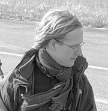
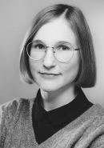

Meet the people behind our project.

::: {.people-grid}

::: {.person}

### Daniel Oberfeld-Twistel

Johannes Gutenberg-Universität Mainz
:::

::: {.person}

### Thirsa Huisman

Johannes Gutenberg-Universität Mainz
:::

::: {.person}

### Ercan Altinsoy

TU Dresden
:::

::: {.person}

### Jonas Krautwurm

TU Dresden
:::

::: {.person}

### Maria Maravich

TU Dresden
:::

:::
