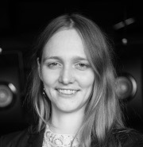
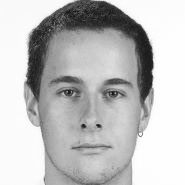

Meet the people behind our project.

  

    
    <h3>Daniel Oberfeld-Twistel</h3>
    
Johannes Gutenberg-Universität Mainz

  

  

    
    <h3>Thirsa Huisman</h3>
    
Johannes Gutenberg-Universität Mainz

  

  

    
    <h3>Ercan Altinsoy</h3>
    
TU Dresdent

  

  

    
    <h3>Jonas Krautwurm</h3>
    
TU Dresden

  

  

    
    <h3>Maria Maravich</h3>
    
TU Dresden

  

